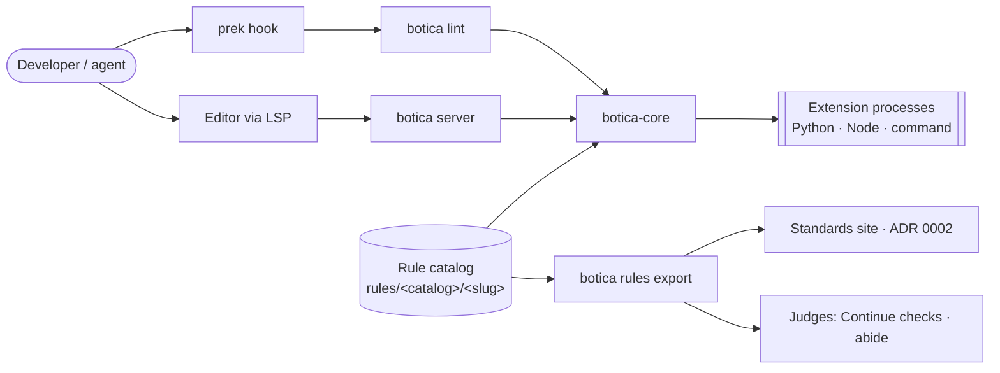
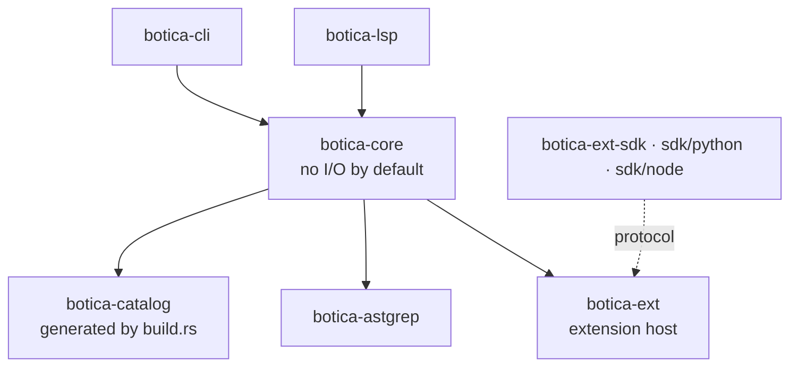

# botica lint: a Rust core with catalogued rules of four kinds and out-of-process extensions

**Status:** proposed

The house standards are enforced today by three `python -c` one-liners in the prek templates
(`file-size-guard`, `no-utils`, `repo-shape`), ten ast-grep YAML rules, and agent judgment for
everything else. The one-liners are not configurable, cover only Python, and two of them are
silently broken: prek hides the output of a passing hook, so the 400-line warning is never seen,
and `repo-shape` matches nothing because nothing ever fills its `{{ import_package }}`
placeholder. Of the 70 `engineering-rules` files, roughly a third could be enforced
deterministically and another third approximated, but there is nowhere to put a check that needs
more than one file's syntax tree.

The linter has to integrate with editors, grow to more languages, stay fast inside a pre-commit
hook, and let each rule be added, configured, and switched off independently. ADR 0002 also makes
its rule catalog the single source of truth for every standard; as amended there, a CES stays
documentation and a rule is what botica evaluates, so the catalog describes rules, not standards.

## Decision

**A Rust core, shipped as the `botica` binary.** Botica does not run Ruff or any other linter;
prek runs each tool as its own hook. `botica lint` is deterministic: it never calls a model or
the network and never needs an API key.

**Workspace layout** (`lint/`). Dependencies point one way, and front-ends never depend on each
other:

The core lints text it is given (`lint_source(path, text, …)`) and does no I/O unless its `fs`
feature is enabled. That is what lets the same engine serve the CLI, the LSP (unsaved buffers),
and later WASM or MCP.

**One rule, one folder, four kinds.** Every rule lives in `rules/<family>/<slug>/` (the family
folder holds a `family.toml` with its code; the linter's own rules live in `rules/botica/`) with
a `rule.toml` (id, code, status, scope, needs, typed options, an optional `ces` reference for the
docs, and one `[[implementations]]` entry per language), a README, and `fixtures/{valid,invalid}`.
Its id is its slug, unique across botica, and its code (`BTSTRUC001`) carries the prefix of its
family. Only external and local catalogs prefix the slug (`acme/no-utils`). The `kind` of each
implementation picks how it runs:

| Kind | Runs | For |
|---|---|---|
| `native` | in the binary | house rules, hot paths, expensive project rules |
| `ast-grep` | in the binary (YAML compiled once) | most syntactic rules, any ast-grep language |
| `extension` | separate process, `runtime = python \| node \| command` | logic YAML cannot express, third-party libraries, repo-local rules |
| `judgment` | never run by lint | catalogued so judges and the site have one source; `covered-by` lists the detectors that enforce part of it |

The engine, not the rule, decides whether a rule is enabled. Selection, severity, per-path
overrides, inline suppressions, and ordering are one central post-processing step, applied the
same way to every kind.

**Lifecycle, modelled on Ruff.** Rules move `preview` → `stable` → `deprecated` → `removed`.
`aliases` keep renamed ids valid in config and suppressions. Preview rules run only on opt-in.

**Extensions run out of process over a versioned protocol.** The protocol is JSON-RPC 2.0 over
stdio, one message per line. Botica sends batches of files with their text and receives
diagnostics as byte ranges. Each extension declares its dependencies; botica builds an isolated,
cached environment for it (uv for Python, npm for Node). The SDKs parse with the ast-grep
bindings, so an extension sees the same node kinds as the core, and a rule can be ported to Rust
under the same id and fixtures. Extensions load only from catalogs the project declares or from
`.botica/rules/`, never by discovery.

**Suppressions.** Two comment channels silence a rule on the line of its finding: `# botica:
ignore[<id>]` in any language with comments, and `# noqa: <code>` in Python. An id is exact (slug,
code or alias); a bare `# noqa` suppresses nothing of botica's. A finding about a whole file is
silenced only with `# botica: ignore-file[<id>]`, and one with no file to comment on is excluded
in the configuration. `unused-suppression` reports a comment that silences nothing, and
`invalid-suppression` one that names an unknown id or is malformed.

**Catalogs and overrides.** The built-in rules (the families and `botica`) are compiled in.
Projects add `.botica/rules/<catalog>/<slug>/` and declared external catalogs; which catalog
names are reserved for those is not decided. A project replaces a built-in rule only when the
replacement declares `replaces = "<id>"` *and* the project config confirms it; suppressions
written for the original keep working.

**Configuration** lives in `botica.toml` or `[tool.botica]` in `pyproject.toml`. It is found by
walking up from the working directory; defining it in both files at once is an error. Unknown
keys and unknown rule ids are errors, and the schema is published as JSON Schema.

**Distribution.** `botica` is the whole package and `lint` is its first subcommand, so no
pipeline is specific to `lint`. The binary is built once per platform (Linux x64 and arm64 with
glibc and musl, macOS x64 and arm64, Windows x64) and repackaged as binary-only PyPI wheels
(maturin) under the name `botica`, released from a `vX.Y.Z` tag and published through PyPI trusted
publishing. Botica starts at 0.7.0 because `v0.1.0` to `v0.6.0` are releases of `scaffolding`. A
mirror repo, `botica-pre-commit`, gives prek a pinnable hook whose tag pins the matching wheel.
The `scaffolding` Python package keeps its name until it is migrated, which is out of scope here.

## Considered options

- **Python implementation.** Faster to start and closer to the rest of the repo. Rejected: it
  costs 20–40 ms of startup before any work, parallelism is limited, and the LSP is slower. A
  later port would mean rewriting the engine, while the declarative rules and fixtures carry over
  either way.
- **Embedding Python with pyo3.** Faster calls into extensions. Rejected: it ties the binary to
  the exact Python it was built against, and a crashing or hanging extension would take the
  linter down with it.
- **Dynamic Rust plugins (`.so`/`.dll`).** Rejected: Rust has no stable ABI, so every plugin
  would have to be built with botica's exact compiler, and loading one is `unsafe`.
  Out-of-process `command` extensions, and WASM later, cover the same need.
- **Tree-sitter directly instead of ast-grep.** More control, but more code to own. ast-grep
  reuses the existing YAML rules, covers about 20 languages, and has bindings the SDKs can share.
- **Model-based ("LLM") rules inside lint.** Rejected: they break determinism and the exit-code
  contract. Judgment stays with external judges (Continue checks, abide), fed by
  `botica rules export`. A model may help *author* a deterministic rule (the `botica-rule-author`
  skill), but never runs at lint time.
- **Flake8-style implicit plugin discovery.** Rejected: results would depend on what happens to
  be installed, and global code prefixes collide. Catalog namespaces and explicit declaration
  replace both.

## Consequences

- **Adding a rule touches only its folder.** CI checks this: a pull request that adds a rule and
  changes anything outside `rules/<catalog>/<slug>/` (or generated files) is flagged as a
  contract change. The catalog, docs, schema, and site pages are generated from the rule
  folders, which avoids agnix's 6–9 hand-synced files per rule.
- **One conformance runner exercises every kind with the same fixtures.** This makes Python→Rust
  migration and `replaces` checkable (`botica rules test --against`).
- **The ten ast-grep rules move into botica and the `ast-grep` hook is retired.** During
  migration, the opt-in setting `compat-ast-grep-ignore` (off by default) makes botica honour
  `# ast-grep-ignore: <slug>`.
- **The `python -c` hooks for CES-71, CES-63, and CES-32 are replaced** (done: the prek templates
  and this repository's `prek.toml` run the `botica` hook from the mirror). `repo-shape` became
  three layout rules (`no-notebooks`, `no-artifacts-in-package`, `no-tests-in-package`) that find
  the code of each ecosystem on their own, or from `code-dirs`, instead of relying on a
  placeholder.
- **Botica now maintains a protocol, two SDKs, and a per-platform release matrix.** These are
  real, ongoing costs.
- **A measurement spike runs before the core is built.** It covers startup, a 10k-file repo,
  LSP latency per buffer, and extension round-trips. If a budget is missed, the design is
  revisited before building on it.
- **Later, not now:** `--diff <base>` rules, autofix with safety levels, WASM extensions, catalogs
  distributed via PyPI or npm, an MCP server, a VS Code client, and architecture-conformance
  rules that read a declared model (e.g. LikeC4) and check real imports against it.
