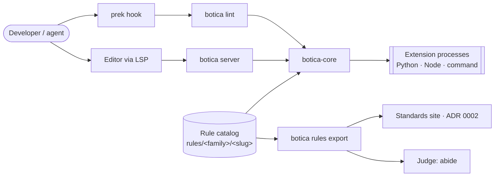
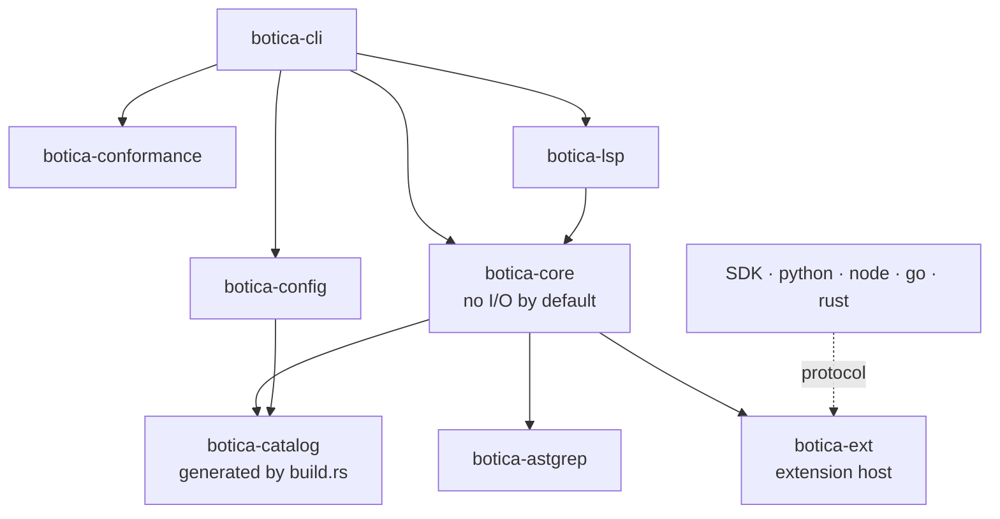

# botica lint: a Rust core with catalogued rules of five kinds and out-of-process extensions

**Status:** accepted

Before botica, the house standards were enforced by three `python -c` one-liners in the prek
templates (`file-size-guard`, `no-utils`, `repo-shape`), ten ast-grep YAML rules, and agent
judgment for everything else. The one-liners were not configurable, covered only Python, and two
of them were silently broken: prek hides the output of a passing hook, so the 400-line warning
was never seen, and `repo-shape` matched nothing because nothing ever filled its
`{{ import_package }}` placeholder. A large part of the `engineering-rules` could be enforced
deterministically and more could be approximated, but there was nowhere to put a check that needs
more than one file's syntax tree.

The linter has to integrate with editors, grow to more languages, stay fast inside a pre-commit
hook, and let each rule be added, configured, and switched off independently. Under ADR 0002 the
catalog is the only documentation of what botica measures; a CES stays documentation and a rule is
what botica evaluates, so the catalog describes rules, not standards.

## Decision

**A Rust core, shipped as the `botica` binary.** Botica does not run Ruff or any other linter;
prek runs each tool as its own hook. `botica lint` is deterministic: it never calls a model or
the network and never needs an API key.

**Workspace layout** (`crates/`). Dependencies point one way, and front-ends never depend on each
other:

The core lints text it is given (`lint_source(path, text, …)`) and does no I/O unless its `fs`
feature is enabled. That is what lets the same engine serve the CLI, the LSP (unsaved buffers),
and later WASM or MCP.

**One rule, one folder, five kinds (ADR 0006 adds `external`).** Every rule lives in `rules/<family>/<slug>/` (the family
folder holds a `family.toml` with its code; the linter's own rules live in `rules/botica/`) with
a `rule.toml` (id, code, status, scope, needs, typed options, an optional `standard` reference for the
docs, and one `[[implementations]]` entry per language), a README, and `fixtures/{valid,invalid}`.
Its id is its slug, unique across botica, and its code (`BTSTRUC001`) carries the prefix of its
family. Only external and local catalogs prefix the slug (`acme/no-utils`). The `kind` of each
implementation picks how it runs:

| Kind | Runs | For |
|---|---|---|
| `native` | in the binary | house rules, hot paths, expensive rules of project scope |
| `ast-grep` | in the binary (YAML compiled once) | most syntactic rules, any ast-grep language |
| `extension` | separate process, `runtime = python \| node \| command`; catalogs of a project only | logic YAML cannot express, third-party libraries, repo-local rules |
| `external` | by another tool, through its configuration | a standard that a tool such as ruff or complexipy enforces; botica checks that the tool is set up (ADR 0006) |
| `judgment` | never run by lint | what no deterministic check can express, even with configuration from the repository (ADR 0005); judges and the site read it from the catalog, and `covered-by` lists the deterministic rules that check part of it |

The engine, not the rule, decides whether a rule is enabled. Selection, severity, per-path
overrides, inline suppressions, and ordering are one central post-processing step, applied the
same way to every kind.

**Lifecycle, modelled on Ruff.** Rules move `preview` → `stable` → `deprecated` → `removed`.
`aliases` keep renamed ids valid in config and suppressions. Preview rules run only on opt-in.

**Extensions run out of process over a versioned protocol.** The protocol is JSON-RPC 2.0 over
stdio, one message per line. Botica sends batches of files with their text and receives
diagnostics as byte ranges. Each extension declares its dependencies: uv builds an isolated,
cached environment for a Python one, and a Node one brings its `node_modules`. The SDKs parse with the ast-grep
bindings, so an extension sees the same node kinds as the core, and a rule can be ported to Rust
under the same id and fixtures. Extensions load only from catalogs the project declares or from
`.botica/rules/`, never by discovery.

`botica lint` runs each active `extension` rule of a catalog of the project as a process of its own,
started in the root of the project, and sends it only the files where the rule applies (its
languages, `files`, `ignores` and the `overrides` of the configuration). In its answer to
`initialize` the process declares the rule it was started for, and may declare the other rules
whose implementation runs the same command; a rule missing or one more fails the process. Each
request names the rule in `rules` and carries the options that the configuration resolves for it
in `options`, by id. A rule of file scope gets the files with their text in batches of
`lint/files`; a rule of project scope gets one `lint/project` with the root of the project and the
paths of the files, and reads them itself. A finding whose `rule` is
not the id of its rule is left out with a warning on stderr; a finding keeps its severity unless
the configuration names one. A process that fails is a failure of the run (exit 2) and leaves the
findings of the other rules as they are. `ExtensionHost` gives a process 120 seconds to answer
`initialize` and 60 seconds to answer `lint/files`, `lint/project` and `shutdown`, and kills one that has not
answered by then; the failure names the method and the deadline. A thread reads the stdout of the
process and another writes its stdin, so a process that does not read a large request is also
killed at the deadline. `timeout` of `[extensions]` in `botica.toml`, in seconds, replaces both
deadlines, and `BOTICA_EXTENSION_TIMEOUT` wins over it; with `on-timeout = "warn"` a process out of
time is a warning and the run goes on without the findings of its rule. `# botica: ignore[<id>]` and `# noqa: <code>` silence a
finding of an extension. The engine does not see the findings of an extension, so the comments
that name an active extension rule are read again after the extensions have run: one that silences
nothing is reported as unused, unless the process of the rule failed. The code of the rule is in its folder and the catalog
loads it as it loads the YAML of an ast-grep rule. An extension is a program that the project runs,
and the built-in catalog is compiled into the binary, which has no folder with such a program: the
built-in catalog takes no `extension` rule.

`botica server` runs the `extension` rules of file scope on the buffers of an editor when the editor
asks for them: the flag `--extensions`, or the option `{"extensions": true}` in the
`initializationOptions` of `initialize`. The switch is in the editor and `botica.toml` has no key
for it. It is off by default, it is heavy, and it is a risk: opening a repository in the editor runs
the scripts of the project. `botica lint` and the server share one `ExtensionPool` (the files where
a rule applies, the command of each implementation, the findings that are the rule's own); `lint`
starts a process, sends it the files and ends it, and the server keeps it for the session. There is
one process for each implementation of a rule, started when the first document in one of its
languages opens, and one thread for each process, so a slow rule does not hold the others. A text
reaches a rule at once when the document opens and after 250 ms without a change when it changes.
The findings of the rules are published after those of the engine, in a second `publishDiagnostics`
with both; a result for a text that has changed, or for a document that was closed, is dropped. A
process that fails is started again up to 3 times and the editor gets a `window/showMessage`
warning each time; after the limit the rule does not run until the server restarts. A rule of
`scope = "project"` does not run on a buffer.

| `runtime` | The rule names | botica runs |
|---|---|---|
| `python` | `file = "<name>.py"` | `uv run --python <version> --script <file>`; the script declares its dependencies (PEP 723) and uv caches its environment. The version is `[extensions] python`: by default the one the project pins, else 3.13; a free-threaded Python is refused. A script that declares `botica` with no version also gets `--with botica[sdk]==<version of botica>`. `botica ext sync` creates the environments beforehand |
| `node` | `file = "<name>.js"` or `.mjs` | `node <file>`, with the `node_modules` the rule brings, if any |
| `command` | `command = ["<argv>", …]`, no `file` | the command, from the root of the project |

The SDK of each language follows the protocol and the version of botica. There are four, for
Python, TypeScript, Go and Rust; any other language speaks the protocol through `command`.

| SDK | Published as | Parses with |
|---|---|---|
| Python | the module `botica.sdk` of the wheel `botica` (`from botica.sdk import rule, serve`); the extra `botica[sdk]` adds `ast-grep-py`, and a script declares `botica[sdk]`, with the version of the botica that runs it | `ast-grep-py` |
| TypeScript | the npm package `@botica/sdk`, from `sdk/node`, released with the same tag | `@ast-grep/napi` |
| Go | the module `github.com/collectiveai-team/botica/sdk/go`, tagged `sdk/go/vX.Y.Z` | the bindings of tree-sitter for Go, with the grammars of ast-grep: the same kinds of node, without the patterns of ast-grep |
| Rust | the crate `botica-ext-sdk`, from `sdk/rust` | `ast-grep-core` |

A rule in Go or Rust runs as WASM: a fourth runtime, `wasm`, takes `file = "<name>.wasm"`, built
from Rust or from Go with TinyGo, and botica runs it in the binary with no toolchain in the project.
`botica lint --ext <command>` runs one
extension by its command, outside any catalog. The conformance runner checks an extension rule with
its fixtures, as any other; `botica rules conform <catalog>` runs it over a catalog, built-in or of a
project.

**Suppressions.** Two comment channels silence a rule on the line of its finding: `# botica:
ignore[<id>]` in any language with comments, and `# noqa: <code>` in Python. An id is exact (slug,
code or alias); a bare `# noqa` suppresses nothing of botica's. A finding about a whole file is
silenced only with `# botica: ignore-file[<id>]`, and one with no file to comment on is excluded
in the configuration. `unused-suppression` reports a comment that silences nothing, and
`invalid-suppression` one that names an unknown id or is malformed.

**Catalogs and overrides.** The built-in rules (the families and `botica`) are compiled in.
Projects add `.botica/rules/<catalog>/` and declared external catalogs; which catalog names are
reserved for those is not decided. A catalog of a project has the layout of the built-in one with
a `catalog.toml` on top: `.botica/rules/<catalog>/catalog.toml` holds its `code` (letters A-Z, not
starting with `BT`, and not a text prefix of the code of another catalog), each family has its
`family.toml`, and each rule its folder, `<catalog>/<family>/<slug>/`. The id of a rule is
`<catalog>/<slug>` and its code is `<catalog code><family code>` plus 3 digits (`ACMESTRUC001`).
A family of a project with the name of a built-in family is legal, because ids and codes do not
collide, and gets a warning unless its `family.toml` says `extends = "<built-in family>"`; the
export then lists its rules under that family. A catalog cannot have the name of a built-in family:
the export would mix its folder with that of the family, so it does not load. It takes rules of every kind but `native`, whose code lives in botica-core. A project replaces a built-in rule only when the
replacement declares `replaces = "<id>"` *and* the project config confirms it; suppressions
written for the original keep working.

**Configuration** lives in `botica.toml` or `[tool.botica]` in `pyproject.toml`. It is found by
walking up from the working directory, and the walk ends at the root of the git repository;
defining it in both files at once is an error. Unknown
keys and unknown rule ids are errors, and the schema is published as JSON Schema.

**Distribution.** `botica` is the whole package and `lint` is its first subcommand, so no
pipeline is specific to `lint`. The binary is built once per platform (Linux x64 and arm64 with
glibc and musl, macOS x64 and arm64, Windows x64) and repackaged as PyPI wheels
(maturin) under the name `botica`, each with the binary and the Python module `botica.sdk`, released from a `vX.Y.Z` tag and published through PyPI trusted
publishing. Botica starts at 0.7.0 because `v0.1.0` to `v0.6.0` are releases of `scaffolding`. A
mirror repo, `botica-pre-commit`, gives prek a pinnable hook whose tag pins the matching wheel.
The `scaffolding` Python package was removed on 2026-10-18, when the recipes of ADR 0006 replaced it.

## Considered options

- **Python implementation.** Faster to start and closer to the rest of the repo. Rejected: it
  adds the startup of an interpreter before any work, parallelism is limited, and the LSP is slower. A
  later port would mean rewriting the engine, while the declarative rules and fixtures carry over
  either way.
- **Embedding Python with pyo3.** Faster calls into extensions. Rejected: it ties the binary to
  the exact Python it was built against, and a crashing or hanging extension would take the
  linter down with it.
- **Dynamic Rust plugins (`.so`/`.dll`).** Rejected: Rust has no stable ABI, so every plugin
  would have to be built with botica's exact compiler, and loading one is `unsafe`.
  Out-of-process `command` extensions, and WASM later, cover the same need.
- **Tree-sitter directly instead of ast-grep.** More control, but more code to own. ast-grep
  reuses the existing YAML rules, supports the languages of its
  [documentation](https://ast-grep.github.io/reference/languages.html), and has bindings the SDKs can share.
- **Model-based ("LLM") rules inside lint.** Rejected: they break determinism and the exit-code
  contract. Judgment stays with an external judge (abide), fed by
  `botica rules export`. A model may help *author* a deterministic rule (the `botica-rule-author`
  skill), but never runs at lint time.
- **Flake8-style implicit plugin discovery.** Rejected: results would depend on what happens to
  be installed, and global code prefixes collide. Catalog namespaces and explicit declaration
  replace both.

## Consequences

- **A rule is its folder.** `build.rs` generates the catalog from `rules/<family>/<slug>/`, which
  avoids agnix's 6–9 hand-synced files per rule.
- **Adding a rule touches only what its kind needs.** CI (`scripts/check_rule_change.py`) flags a
  change that adds a rule and touches anything else as a contract change, which a maintainer
  accepts by label. An ast-grep, extension or judgment rule needs its folder; a native rule also
  the Rust of the core that implements it; the built-in catalog also the files that list it, which
  are pinned on purpose. The same check applies to a project catalog, whose rules get their
  folder and nothing else.
- **One conformance runner exercises the rules with the same fixtures.** It runs each rule in its
  variants and compares the result with `fixtures/expected.json`, which makes a Python→Rust
  migration and `replaces` checkable.
- **The ast-grep rules are rules of the catalog, and there is no `ast-grep` hook.** A
  `# ast-grep-ignore: <slug>` comment suppresses nothing; `# botica: ignore[<slug>]` replaces it.
- **The `python -c` hooks for CES-71, CES-63, and CES-32 are replaced** by the `botica` hook of the
  mirror. `repo-shape` became three layout rules (`no-notebooks`, `no-artifacts-in-package`,
  `no-tests-in-package`) that find the code of each ecosystem on their own, or from `code-dirs`,
  instead of relying on a placeholder.
- **Botica maintains a protocol, four SDKs (Python, Node, Go and Rust), and a per-platform release
  matrix.**
- **Later, not now:** `--diff <base>` rules, autofix with safety levels, catalogs
  distributed via PyPI or npm, an MCP server, a VS Code client, and architecture-conformance
  rules that read a declared model (e.g. LikeC4) and check real imports against it.

## Not built yet

What this ADR decides and the code does not have. Delete a line when it ships.

- The editor front-end beyond diagnostics: `botica-lsp` and `botica server` publish the findings
  of the native and pattern rules for open buffers by their `run-on`, the rules of project scope at
  each save, and those of the extension rules when the editor asks for them; they sync
  incrementally, negotiate the position encoding and read the configuration again when it is
  saved. Missing: code actions, hover, a client for VS Code and an extension for Zed. No
  extension has run in a real editor: the tests speak the protocol.
- The runtime `wasm`, after the first release. The Python SDK, `botica.sdk` with the extra `botica[sdk]`, is built. So are
  the TypeScript one in `sdk/node`, the Rust one, `botica-ext-sdk` in `sdk/rust`, and the
  Go one in `sdk/go`; none of the three is published (npm, crates.io, a tag of the module) and
  none parses with ast-grep yet. Until the runtime `wasm` exists, a rule in Rust or Go runs as a
  program of the runtime `command`.
- Catalogs fetched from elsewhere: a git repository, PyPI or npm. The catalogs of the project in
  the `rule-dirs` folders (`.botica/rules/` by default) and those that `[catalogs]` declares by
  `path` load and their `extension` rules run. A catalog name is the folder name or the key, is
  unique, and is not the name of a built-in family.
