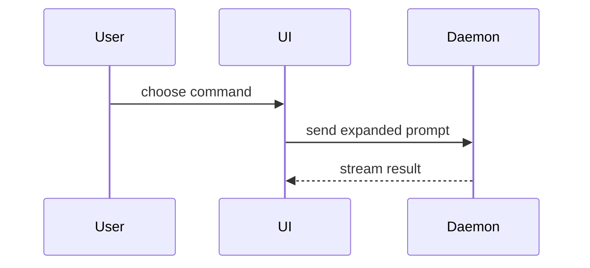

Read and use `.github/pull_request_template.md` from the repository the PR targets.
That file defines the body structure: preserve its headings, order, and required
fields rather than rewriting the template here. If it is missing, ask the user
which template to use instead of inventing one.

## Delivery context

Run `botica explain pr-small-by-intent` before choosing the publication boundary. Read the spec,
delivery plan and slice review records. Follow the local-commit and review procedure in
`../engineering-pr-review/references/delivery.md` when the delivery has several tickets.

Prepare one PR for the integrated delivery. Do not create a PR just because a ticket or commit is
complete. If the plan splits the delivery, state the reason for that boundary and the dependencies.
Closing or rewriting existing PRs requires the user's authorization.

### Explicit stack mode

Use a remote stack only when the user explicitly requests it or the delivery plan records
separate delivery boundaries. Preserve the local ticket commits; do not turn each ticket into
a PR. Pin the integration base and each boundary head before publication.

Create stack members as drafts and label deferred members `botica:stack-member` before
marking the tip ready. The role and mutation workflows defer expensive work on drafts and
marked members. The review gate stays incomplete for deferred members, never a passing
approval inherited from the tip. The tip runs its own planned checks.

Record cumulative local review evidence against the integration base and each boundary's
evidence in the delivery plan. Do not assume native stack event fields or a first parent prove
the review base; use the pinned revisions and the observations of ticket 36. A deferred member
is not individually merge-ready until its own evidence is validated. One integrated PR remains
the default when those independent delivery boundaries do not exist.

Use the template's existing sections to link the spec, covered tickets and slice review evidence.
Include the integration checks, unresolved findings and anything not run. Use closing references
only for tickets whose acceptance criteria the delivery satisfies. If several slices are included,
show how their behaviours serve the stated intent instead of listing commits without context.

## Sections

Skip all preambles and keep prose brief. Use the user's domain language from `GLOSSARY.md`.

### Summary

Pick the smallest view that makes the key point clear.

- Show logic or an algorithm as pseudocode:

```text
on(save)
  if content is unchanged
    return cached result
  write new content
  return fresh result
```

- Show runtime control flow as a call tree:

```text
submitForm
  createSession
    persistPrompt
    launchAgent
  navigateToSession
```

- Show UI structure as a component tree, including state and module boundaries that matter:

```text
<SessionPage> (apps/example/src/routes/session.tsx)
  useSessionEvents()
  <SessionToolbar>
    <RunSkillButton> (packages/ui)
```

- Show file responsibility or a broad refactor as a shallow file tree:

```text
src/
├── commands/       # parses user actions
├── sessions/       # owns session state
└── transport/      # sends API requests
```

- Show component interaction, control flow, or data flow with Mermaid:



- Use `diff` when the point is what changes and the surrounding shape already exists. Match the diff shape to the topic.

For a component change:

```diff
 <SessionPage>
   useSessionEvents()
   <SessionToolbar>
+    <RunSkillButton />
   <SessionTimeline>
+    <SkillResultCard />
```

For a file-layout change:

```diff
 src/
 ├── commands/
+│   └── show-me.ts       # expands the slash command
 ├── sessions/
-└── transport.ts
+└── transport/
+    ├── client.ts
+    └── stream.ts
```

For a call-tree or call-stack change:

```diff
 submitForm
   createSession
     persistPrompt
+    expandSkillMention
     launchAgent
-  navigateToSession
+  navigateToSession
+    subscribeToEvents
```

For a state or control-flow change:

```diff
 on(save)
-  write content
+  if content is unchanged
+    return cached result
+  write new content
+  invalidate cache
```

- Show the whole block when most of it is new, when omitted context would hide ownership or order, or when the user needs a copyable target shape:

```ts
function expandSkill(command: string): string {
  const skillName = command.slice(1);
  return `use the ${skillName} skill`;
}
```

#### Guidance

Place each visual next to the short text it supports. Keep only the calls, files, props, states, and boundaries needed to answer the user's current question or the options to resolve the current discussion point.

You may use one of these, you may use several, it is unlikely you will use all of them. Use your judgement and don't overwhelm the user.

### Evidence

Concrete evidence that the change works. Show a before and after.

Screenshots are the strongest evidence when the environment is set up for it and the change is visual.

Execution-based evidence comes next: test results, console output. Show the exact test that now fails and passes, using pseudocode.

### Merge Danger

Describe whether it's a one-way or two-way door. You can walk back through two-way doors, but not one-way doors. A PR that is cheap to roll back is lower risk. Changes that involve destructive actions or hard-to-reverse decisions are one-way doors.

The blast radius is the potential impact or scope of the changes introduced by this PR. Examples are layout shift, breakages for consumers, mobile responsiveness, etc.

Credits and sources: [`references/CREDITS.md`](references/CREDITS.md).
